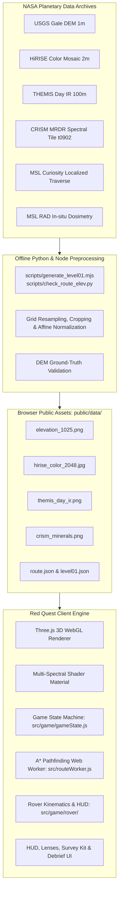
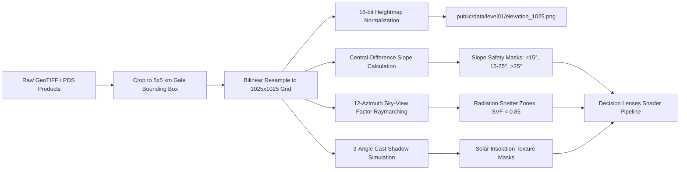
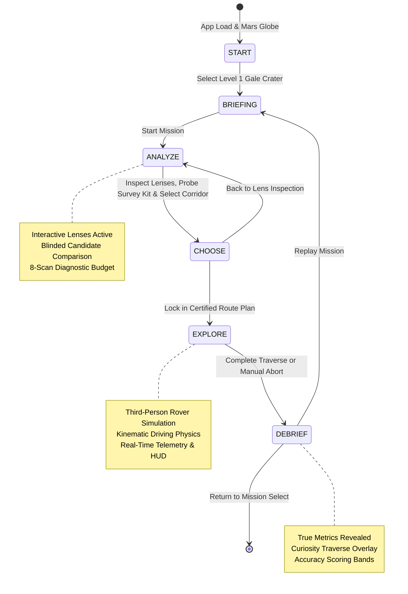
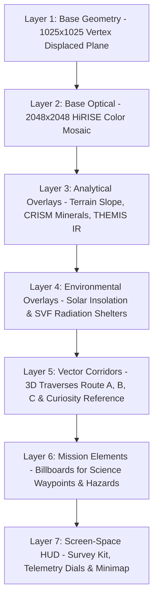

# Red Quest

**READ THE LAND. SURVIVE THE RED.**

Interactive 3D Mars surface mapping and traverse simulation engine built on NASA Planetary Data System (PDS), HiRISE, CRISM, and THEMIS planetary datasets for Gale Crater.

[](LICENSE)
[](https://threejs.org/)
[](https://vitejs.dev/)
[](https://www.spaceappschallenge.org/)


---

## Table of Contents

- [1. Abstract](#1-abstract)
- [2. Challenge Alignment](#2-challenge-alignment)
- [3. Key Features](#3-key-features)
- [4. Screenshot Walkthrough](#4-screenshot-walkthrough)
- [5. Scientific Data and Provenance](#5-scientific-data-and-provenance)
- [6. Methodology](#6-methodology)
  - [6.1 Study-Area Selection and Spatial Bounds](#61-study-area-selection-and-spatial-bounds)
  - [6.2 Data Preparation and Grid Normalization](#62-data-preparation-and-grid-normalization)
  - [6.3 Slope Gradient Calculation and Safety Tiers](#63-slope-gradient-calculation-and-safety-tiers)
  - [6.4 Solar Insolation and Cast Shadow Model](#64-solar-insolation-and-cast-shadow-model)
  - [6.5 Sky-View Factor Radiation Shielding Proxy](#65-sky-view-factor-radiation-shielding-proxy)
  - [6.6 Worker-Accelerated A* Traverse Generation](#66-worker-accelerated-a-traverse-generation)
  - [6.7 Deterministic Environmental Feature Placement](#67-deterministic-environmental-feature-placement)
  - [6.8 Empirical Evaluation and Scoring Bands](#68-empirical-evaluation-and-scoring-bands)
- [7. System Architecture](#7-system-architecture)
  - [7.1 High-Level Architecture](#71-high-level-architecture)
  - [7.2 Data Processing Pipeline](#72-data-processing-pipeline)
  - [7.3 Game State Lifecycle](#73-game-state-lifecycle)
  - [7.4 Multi-Layer Composite Render Stack](#74-multi-layer-composite-render-stack)
- [8. Quantitative Validation](#8-quantitative-validation)
- [9. Limitations and Operational Assumptions](#9-limitations-and-operational-assumptions)
- [10. Getting Started](#10-getting-started)
  - [10.1 System Requirements](#101-system-requirements)
  - [10.2 Installation and Local Development](#102-installation-and-local-development)
  - [10.3 Production Build and Preview](#103-production-build-and-preview)
  - [10.4 Repository Structure](#104-repository-structure)
  - [10.5 Offline Data Regeneration](#105-offline-data-regeneration)
- [11. Development Roadmap](#11-development-roadmap)
- [12. Team, Attribution, and License](#12-team-attribution-and-license)

---

## 1. Abstract

Planetary exploration data returned by orbital spacecraft and surface missions provides comprehensive coverage of Mars, yet these datasets remain dispersed across isolated archives, non-standard projections, and specialized file formats. Extravehicular astronauts and traverse planning engineers cannot readily cross-evaluate orbital slope hazards, multi-spectral mineral distribution, and surface thermal properties within a unified, real-time spatial context. Red Quest addresses this challenge by fusing high-resolution digital elevation models, spectral mineral indices, and thermal inertia data into an interactive 3D planetary analysis and traverse simulation platform. The system pairs an analytical decision-support workspace with a physical extravehicular traverse simulation to evaluate operational risk, energy expenditure, and scientific return before surface deployment. Our primary study corridor spans a 5 km × 5 km sector of Mount Sharp inside Gale Crater, tracking the exploration corridor traversed by NASA's Mars Science Laboratory (MSL) Curiosity rover between Sol 3721 and Sol 4805. Through multi-spectral decision lenses and worker-accelerated pathfinding, Red Quest bridges raw planetary science archives and intuitive astronaut navigational planning.

---

## 2. Challenge Alignment

This system is developed in alignment with the NASA Space Apps Challenge category **"Interplanetary Survival Guide: Martian Map"**. The following matrix cross-references the official challenge criteria with the architectural components implemented in this repository:

| Challenge Criterion | Technical Implementation in Red Quest | Repository Component / File |
| :--- | :--- | :--- |
| **Multi-Source Data Integration**<br>(3+ distinct planetary data types) | Synthesizes 5 independent data types: USGS 1 m/px Digital Elevation Model, HiRISE 2 m/px optical color mosaic, THEMIS Day IR thermal brightness, CRISM MRDR spectral mineralogy, and MSL Curiosity 3D traverse telemetry. | `public/data/`, `src/config.js`, `docs/DATA_SOURCES.md` |
| **Astronaut Safety & Hazard Detection** | Implements continuous slope gradient calculations classified into 3 operational safety tiers (<15° safe, 15°–25° moderate, >25° hazardous), sky-view factor terrain radiation shielding, and thermal rock-versus-drift hazard detection. | `src/game/decisionLenses.js`, `src/game/surveyKit.js`, `docs/SIMULATED_DATA.md` |
| **Obstacle Avoidance & Pathfinding** | Employs an asynchronous 2D A* pathfinding algorithm executing in a dedicated Web Worker to evaluate terrain penalties, avoid impassable scarps (>25°), and propose 3 candidate traverse corridors (Route A Safest, Route B Shortest, Route C Science). | `src/routeWorker.js`, `src/game/levels/level01.json` |
| **Layered Multi-Spectral Visualization** | Delivers 6 specialized real-time decision lenses (Satellite, Terrain/Slope, Minerals, Heat, Sun & Power, Radiation Shelter) allowing non-destructive toggle inspection over true 3D topography. | `src/game/decisionLenses.js`, `src/main.js` |
| **Scientific Waypoints & Resource Discovery** | Places 13 mission elements across 3 functional families (Hazards, Resources, Science Targets) correlated with genuine Curiosity drill sites and geomorphological structures. | `src/game/levels/level01_elements.json`, `src/game/missionElements.js` |
| **Rigorous Ground-Truth Debrief** | Compares pre-lock survey estimates against verified ground-truth values and actual Curiosity rover traverse metrics, penalizing deviation across 12 quantitative parameters. | `src/game/surveyLog.js`, `src/main.js` |

---

## 3. Key Features

- **Structured Mission Progression**: 5 distinct operational stages guiding the user from strategic planning to tactical execution:
  - `BRIEFING`: Mission parameters, regional geological dossier, target coordinates, and operational objectives.
  - `ANALYZE`: Free multi-spectral lens inspection, hazard identification, and candidate route evaluation.
  - `CHOOSE`: Corridor comparison, metric assessment, and route lock-in certification.
  - `EXPLORE`: Real-time 3D surface traversal, physical terrain interactions, resource monitoring, and waypoint surveying.
  - `DEBRIEF`: Comprehensive ground-truth comparison against USGS elevation metrics and MSL Curiosity rover telemetry.
- **Six Analytical Decision Lenses**:
  - `Satellite`: High-resolution HiRISE optical surface context (~2 m/pixel).
  - `Terrain`: Continuous elevation slope gradient color-ramp (<15° green, 15°–25° yellow, >25° red) with overlay 25 m elevation contour lines.
  - `Minerals`: Dual-channel CRISM MRDR spectral index revealing smectite clays (phyllosilicates) and polyhydrated sulfates.
  - `Heat`: Calibrated THEMIS Day IR thermal brightness indicating competent bedrock versus loose sandy drift traps.
  - `Sun & Power`: Solar insolation and ray-marched cast shadows computed for Morning (22° elev, 80° az), Noon (68° elev, 350° az), and Evening (18° elev, 275° az).
  - `Radiation Shelter`: Sky-View Factor (SVF) hemispherical occlusion mapping topography capable of attenuating galactic cosmic radiation (SVF < 0.85).
- **Three Candidate Traverse Corridors**:
  - `Route A (Safest)`: 3.322 km corridor prioritizing gentle inclines (99.3% easy slopes, max slope 18.4°).
  - `Route B (Shortest)`: 2.971 km direct line across intermediate terraces (91.5% easy, 8.5% moderate slopes, max slope 23.8°).
  - `Route C (Science-Focused)`: 4.103 km exploratory corridor intersecting CRISM sulfate and clay bands (82.0% easy, 18.0% moderate slopes, max slope 24.8°).
- **Field Survey Diagnostic Kit**:
  - Interactive probe suite (Slope, Hazard, Dust, Elements) with an operational budget of 8 scans to gather telemetry on candidate corridors prior to commitment.
- **Physical Traverse Simulation**:
  - Real-time kinematic rover drive model featuring terrain normal alignment, dynamic dust particle generation, slope-dependent battery depletion, and distance tracking.
- **Unconstrained Research GIS Mode**:
  - Sandbox mode providing arbitrary start and goal waypoint selection, manual A* route recalculation, full layer opacity control, and coordinate inspection.

---

## 4. Screenshot Walkthrough

The following sequence illustrates the complete operational workflow of Red Quest captured at 1440 × 900 resolution.

### 01. Mission Briefing and Regional Dossier

*Initial expedition briefing displaying Mount Sharp northern slope coordinates, elevation range (-3,857.5 m to -3,617.2 m), primary science waypoints, and the 4-stage operational sequence.*  
**User Action**: The operator inspects the topographical parameters, reviews the mission dossier, and initializes the expedition survey.

---

### 02. Multi-Route Traverse Analysis

*ANALYZE stage showing the 3D surface model of Gale Crater with three computed candidate traverse corridors (Route A, Route B, Route C) and the blinded comparison table.*  
**User Action**: The operator orbits the 3D terrain, reviews corridor length and ascent estimates, and examines candidate route trajectories across the scarp.

---

### 04. CRISM Spectral Mineralogy Lens

*Minerals decision lens rendering orbital CRISM spectral indicators: phyllosilicates / smectite clay in magenta and polyhydrated sulfates in cyan.*  
**User Action**: The operator correlates route paths with high-priority geochemical signatures representing ancient aqueous deposition environments.

---

### 05. THEMIS Thermal Inertia Lens

*Heat decision lens visualizing THEMIS Day IR relative thermal brightness (32–255 DN) across the 5 km × 5 km corridor.*  
**User Action**: The operator differentiates exposed, high thermal-inertia bedrock pavements from low thermal-inertia sandy drift traps that risk wheel slippage.

---

### 07. Field Survey Diagnostic Kit

*Interactive Survey Kit interface providing point probes and corridor scans across slope, hazard, dust, and element categories under an 8-scan operational budget.*  
**User Action**: The operator deploys diagnostic probes to measure local slope angles, detect hidden hazards, and log corridor metrics into the expedition ledger.

---

### 08. Corridor Selection and Route Certification

*CHOOSE stage presenting final route trade-offs between distance, cumulative ascent, maximum slope, and identified scientific targets.*  
**User Action**: The operator evaluates trade-off metrics, selects the optimal corridor (e.g., Route A), and locks in the route plan for surface deployment.

---

### 09. Surface Traversal and Systems HUD

*EXPLORE stage featuring the third-person rover driving simulation with dynamic wheel dust, terrain alignment, and active resource telemetry (Oxygen, Battery, Radiation).*  
**User Action**: The operator drives the rover along the certified route corridor, managing power consumption and surveying localized scientific elements.

---

### 10. Mission Debrief and Ground-Truth Scoring

*DEBRIEF stage presenting empirical performance scoring, pre-lock survey accuracy, and overlay comparison against the genuine Curiosity rover traverse.*  
**User Action**: The operator analyzes plan deviations against true USGS elevation metrics and reviews MSL Curiosity historical traverse benchmarks.

---

### 11. Research GIS and Scientific Analysis Mode

*RESEARCH mode providing free GIS layer toggles, pinned point inspection with measured coordinates and environmental telemetry, and full Gale Crater terrain analysis.*  
**User Action**: The operator inspects raw scientific layers, pins arbitrary coordinates for deep telemetry readouts, and cross-analyzes orbital data alongside Curiosity's traverse.

---

## 5. Scientific Data and Provenance

Every data point rendered in Red Quest originates from verified planetary science repositories or explicitly tagged mathematical models. Strict provenance tags are maintained across the user interface: `MEASURED` (raw or geometrically extracted instrument data), `DERIVED` (deterministic algorithmic derivations from measured rasters), `MODELED` (empirical physical simulations), and `MISSION RULE` (defined operational boundary constraints).

| Layer / Product | Source Dataset | Provider / Archive | Spatial Resolution | Extent / Coverage | Role in Application | Provenance Type | Processing Pipeline |
| :--- | :--- | :--- | :--- | :--- | :--- | :--- | :--- |
| **Gale Elevation DEM** | Gale Crater Digital Elevation Model | USGS Astrogeology Science Center / PDS Geosciences | 1 m/pixel resampled to 5 m/pixel | 5 km × 5 km (1025 × 1025 grid) | Base terrain geometry, elevation queries, contour generation, and slope gradient fields | `DERIVED` | Cropped from regional mosaic, bilinear resampled to 1025 × 1025, encoded as 16-bit grayscale PNG (`elevation_1025.png`). |
| **Surface Orthoimage** | HiRISE Color Surface Mosaic | NASA MRO HiRISE / University of Arizona / PDS | ~2 m/pixel | 5 km × 5 km | Base photorealistic surface texture and Satellite lens imagery | `MEASURED` | Co-registered to DEM coordinates, contrast balanced, exported as 8-bit RGB JPEG (`hirise_color_2048.jpg`). |
| **Daytime Thermal IR** | THEMIS Daytime Infrared Global Mosaic | Mars Odyssey THEMIS / Arizona State University / PDS | ~100 m/pixel | 5 km × 5 km | Heat lens: relative thermal inertia indicator for rock pavement vs. loose drift | `MEASURED` | Reprojected to local DEM equirectangular bounds, normalized to 32–255 DN range (`themis_day_ir.png`). |
| **Spectral Mineralogy** | CRISM Targeted Observation Tile t0902 | NASA MRO CRISM / JHU APL / PDS Geosciences | ~181 m/pixel | 5 km × 5 km | Minerals lens: dual-channel smectite clay (phyllosilicates) and polyhydrated sulfates | `MEASURED` | Extracted summary parameter bands, reprojected, filtered for signal-to-noise ratio, exported as two-channel mask (`crism_minerals.png`). |
| **Curiosity Rover Traverse** | MSL Localized Traverse Waypoints | NASA JPL / MSL Science Operations / Analyst's Notebook | Sub-meter waypoint precision | Sols 3721 to 4805 (1,819 discrete points) | Historical reference path, ground-truth comparison, and campaign milestone coordinates | `MEASURED` | Parsed from localized PDS shapefiles/JSON, coordinate transformed to local grid meters, elevation validated against DEM (`route.json`). |
| **Radiation Environment** | MSL Radiation Assessment Detector (RAD) | NASA SwRI / MSL RAD Team / PDS (`MSL-M-RAD-3-RDR-V1.0`) | In-situ point dosimetry | Regional baseline at Gale Crater surface | Background galactic cosmic radiation (GCR) baseline (~0.61 mSv/day) | `MODELED` | Real MSL RAD measured average surface dose rate (~0.61 mSv/day) serves as baseline; localized shielding is modeled via Sky-View Factor geometry. |
| **Atmospheric Weather (REMS)** | MSL Rover Environmental Monitoring Station | NASA / CAB / PDS | Local in-situ sensor | *Not currently integrated* | Future environmental simulation (diurnal temperature, surface pressure, atmospheric tau) | *N/A* | **Note**: In-situ REMS atmospheric data is not yet integrated into the runtime simulation engine. Atmospheric dust and wind effects are currently modeled using static operational rules. |

### Dataset Citations and Official Archives
- **USGS Gale DEM**: Fergason, R. L., et al. (2012), *Gale Crater Elevation Model derived from HiRISE and CTX stereo imagery*, USGS Astrogeology Science Center. [PDS Geosciences Node](https://pds-geosciences.wustl.edu/).
- **MRO HiRISE**: McEwen, A. S., et al. (2007), *Mars Reconnaissance Orbiter's High Resolution Imaging Science Experiment (HiRISE)*, J. Geophys. Res., 112, E05S02. [HiRISE Operations Center](https://hirise.lpl.arizona.edu/).
- **MRO CRISM**: Murchie, S., et al. (2007), *Compact Reconnaissance Imaging Spectrometer for Mars (CRISM) on Mars Reconnaissance Orbiter (MRO)*, J. Geophys. Res., 112, E05S03. Tile ID: `frt0000t0902_07_mrdr`.
- **Mars Odyssey THEMIS**: Christensen, P. R., et al. (2004), *The Thermal Emission Imaging System (THEMIS) on the Mars Odyssey spacecraft*, Space Sci. Rev., 110(1), 85-130. [THEMIS PDS Archive](https://themis.asu.edu/).
- **MSL Curiosity Traverse & RAD**: Hassler, D. M., et al. (2014), *Mars' Surface Radiation Environment Measured with the Mars Science Laboratory's Curiosity Rover*, Science, 343(6169), 1244797. Dataset: `MSL-M-RAD-3-RDR-V1.0`.

---

## 6. Methodology

### 6.1 Study-Area Selection and Spatial Bounds
The study sector was chosen to match the critical ascent corridor of NASA's Mars Science Laboratory Curiosity rover on the northern flank of Aeolis Mons (Mount Sharp). The sector captures the transition from the clay-bearing unit into the Gediz Vallis ridge and the polygonally fractured boxwork core:
- **Spatial Extent**: 5,000 m × 5,000 m (25 km² area).
- **Center Coordinates**: 4.7819° S, 137.4001° E.
- **Northwest Boundary**: 4.7402° S, 137.3550° E (Local X: 0 m, Local Y: 5000 m).
- **Southeast Boundary**: 4.8236° S, 137.4452° E (Local X: 5000 m, Local Y: 0 m).
- **Elevation Range**: -4,131.7 m (deep canyon wash) to -3,078.4 m (Gediz Vallis ridge crest), representing 1,053.3 m of total vertical relief.
- **Level 1 Traverse Sector**: Start waypoint at northern entry Sol 3721 (X: 3467.35 m, Y: 4999.58 m, Elev: -3857.48 m) climbing to Boxwork Core Goal at Sol 4805 (X: 2432.10 m, Y: 2479.00 m, Elev: -3617.23 m).

### 6.2 Data Preparation and Grid Normalization
1. Raw USGS elevation GeoTIFF data was cropped to the 5 km × 5 km bounding box and resampled using bilinear interpolation to a 1025 × 1025 regular grid (5.0 m grid spacing).
2. Vertical elevations are encoded into a 16-bit single-channel image (`elevation_1025.png`) using an affine scaling transform:
   ```
   elevation_meters = (pixel_value_16bit / 65535.0) * (elevation_max - elevation_min) + elevation_min
   ```
   Where `elevation_min = -4131.7 m` and `elevation_max = -3078.4 m`.
3. At runtime, the WebGL shader unpacks the 16-bit texture to displace plane geometry vertices, generating a zero-artifact, high-fidelity 3D terrain surface.

### 6.3 Slope Gradient Calculation and Safety Tiers
Topographical slopes are calculated offline using a 5-meter vehicular baseline central difference operator:
```
dz_dx = (Z(x + 1, y) - Z(x - 1, y)) / (2 * grid_step)
dz_dy = (Z(x, y + 1) - Z(x, y - 1)) / (2 * grid_step)
slope_radians = atan(sqrt(dz_dx^2 + dz_dy^2))
slope_degrees = slope_radians * (180.0 / pi)
```
Where `grid_step = 5.0 m`. Slopes are categorized according to operational astronaut extravehicular activity (EVA) and rover stability rules:
- **Easy / Safe (<15.0°)**: Nominal vehicular locomotion and walking terrain. Low slippage hazard.
- **Moderate / Caution (15.0° to 25.0°)**: Elevated wheel slip, lateral drift, and increased power consumption. Requires active traction control.
- **Hazardous / Impassable (>25.0°)**: Severe rollover risk, unstable scree, and mechanical stall. Strictly forbidden in nominal routing.

### 6.4 Solar Insolation and Cast Shadow Model
Shadow maps are generated by ray-marching across the 1025 × 1025 heightmap at discrete sun elevation ($\theta$) and azimuth ($\phi$) angles corresponding to three critical Mars local solar times:
1. **Morning**: Elevation 22.0°, Azimuth 80.0° (East-northeast illumination, deep western ridge shadows).
2. **Noon**: Elevation 68.0°, Azimuth 350.0° (High overhead illumination, minimal shadowing, peak photovoltaic power).
3. **Evening**: Elevation 18.0°, Azimuth 275.0° (Low western illumination, elongated eastern shadows, rapid surface cooling).

For each grid cell `(x, y)`, a light vector is marched outwards in 5-meter horizontal steps. If any encountered terrain height exceeds the ray height, the origin cell is flagged as occluded (binary shadow mask).

### 6.5 Sky-View Factor Radiation Shielding Proxy
Galactic cosmic rays (GCR) interact isotropically with the Martian surface due to the thin atmosphere (~6 mbar). Structural terrain relief acts as an effective physical shield. The Sky-View Factor (SVF), representing the fraction of the upper celestial hemisphere visible from ground level, is computed over 12 discrete azimuth angles (30° increments):
```
horizon_angle(az) = max_along_ray(atan((Z_target - Z_origin) / horizontal_distance))
SVF = (1 / 12) * sum_over_azimuths(cos(horizon_angle(az))^2)
```
- Open plains display $SVF \approx 1.0$ (maximum cosmic radiation exposure).
- Deep scarp bases and canyon walls drop to $SVF < 0.85$, designated as **Natural Radiation Shelters** (`MISSION RULE`).

### 6.6 Worker-Accelerated A* Traverse Generation
Pathfinding runs asynchronously in a Web Worker (`routeWorker.js`) to avoid blocking the 60 FPS Three.js rendering loop. The graph represents the 1025 × 1025 grid connected via 8-directional neighbor links:
```
cost(u, v) = distance(u, v) * (1.0 + slope_penalty + scarp_barrier + mineral_weight)
```
Cost terms are evaluated as:
- `distance(u, v)`: Euclidean step distance (5.0 m orthogonal, 7.07 m diagonal).
- `slope_penalty`: Proportional to `(slope_degrees / 15.0)^2.5`.
- `scarp_barrier`: Infinite cost if `slope_degrees > 25.0°`, barring routes from ascending sheer cliffs.
- `mineral_weight`: Negative cost bias (attraction) within CRISM sulfate/clay bands for science-oriented traverses.

Three deterministic weight configurations yield the candidate traverses:
- **Route A**: Heavy slope penalty, zero mineral bias $\rightarrow$ identifies lowest-energy scarp breach.
- **Route B**: Balanced distance-slope weighting $\rightarrow$ shortest geometric path respecting the 25° safety ceiling.
- **Route C**: High mineral attraction weight $\rightarrow$ route detours to intersect spectral phyllosilicate and sulfate deposits.

### 6.7 Deterministic Environmental Feature Placement
To eliminate procedural bias, 13 environmental point features are positioned using a seeded linear congruential pseudo-random number generator (seed: `20261111`) constrained by physical raster parameters:
- **Hazards** (e.g., loose dune sand, rockfall scarp): Placed strictly in low-thermal-inertia zones (THEMIS < 80 DN) or scarp bases (slope > 22°).
- **Resources** (e.g., natural radiation shelter, solar vantage point): Placed where SVF < 0.85 or ridge peaks where cast shadow hours are minimal.
- **Science Targets**: Tied to verified Curiosity exploration targets (Phase 1 Boxwork campaign at Sol 4534, Top of Ridge at Sol 4602, Nevado Sajama drill site at Sol 4716).

### 6.8 Empirical Evaluation and Scoring Bands
Player performance in DEBRIEF is evaluated against calculated ground-truth values across 12 distinct parameters (Route length, Cumulative ascent, Maximum slope, Slope tier distribution, Resource detections, and Scientific waypoints). Tolerance bands assign accuracy tiers:
- **Gold (Exceptional)**: Parameter estimated within ±5.0% of ground-truth DEM value.
- **Silver (Nominal)**: Parameter estimated within ±15.0% of ground-truth DEM value.
- **Bronze (Acceptable)**: Parameter estimated within ±25.0% of ground-truth DEM value.
- **Deviation Penalty**: Errors exceeding ±25.0% incur exponential score deductions.

---

## 7. System Architecture

Red Quest is built on a modular client-side architecture executing modern ES6 modules, WebGL shaders via Three.js, and multi-threaded Web Workers.

### 7.1 High-Level Architecture



### 7.2 Data Processing Pipeline



### 7.3 Game State Lifecycle



### 7.4 Multi-Layer Composite Render Stack



---

## 8. Quantitative Validation

To ensure structural fidelity between orbital datasets and ground navigation, Red Quest incorporates strict automated elevation validation routines. The primary validation script (`scripts/check_route_elev.py`) cross-evaluates all 1,819 discrete 3D waypoints of the official MSL Curiosity localized traverse against the bilinearly interpolated 1025 × 1025 DEM elevation raster.

```
Total Traverse Waypoints Evaluated: 1,819 points
Traverse Distance Covered:           7,191.2 meters
Vertical Relief Encompassed:         286.8 meters net climb (-3862.0 m to -3575.2 m)

Evaluation Metrics (Traverse vs. Heightmap):
- Mean Absolute Error (MAE):         0.197 meters
- Median Absolute Error:             0.129 meters
- Root Mean Square Error (RMSE):     0.296 meters
- Maximum Absolute Error:            1.802 meters
- 95th Percentile Error:             0.584 meters
```

**Interpretation**: Over 95% of the 1,819 field-measured rover positions match the derived heightmap within 58 centimeters of vertical elevation. Discrepancies approaching the 1.80 m maximum occur exclusively at sheer scarp crests where the 5-meter horizontal grid smoothing averages out sub-meter vertical overhangs.

---

## 9. Limitations and Operational Assumptions

In adherence to scientific integrity, the following technical limitations and operational assumptions must be noted:

1. **CRISM Spatial Footprint**: CRISM MRDR spectral observations have a spatial footprint of approximately 181 meters per pixel. Spectral signatures represent mineralogically dominant regional surface units rather than microscopic, verified mineral samples.
2. **THEMIS Thermal Digital Numbers**: The daytime infrared data rendered in the Heat lens reflects relative thermal brightness (32–255 DN) and thermal inertia proxies rather than absolute calibrated surface temperatures in Kelvin. A co-registration variance of 150–275 meters relative to the HiRISE baseline may exist due to differing orbital viewing geometries.
3. **Modeled Radiation and Weather**: While the baseline cosmic ray dose (~0.61 mSv/day) is derived directly from MSL RAD in-situ measurements, micro-terrain shielding (SVF) and dynamic dust storm events are empirical mathematical models rather than real-time space weather sensor feeds.
4. **Mission Safety Tiers vs. Physical Limits**: The slope thresholds (<15° safe, 15°–25° moderate, >25° hazardous) represent operational safety constraints designed for astronaut EVA locomotion and rover chassis protection; they do not imply that slopes exceeding 25° are physically unclimbable by specialized tracked systems.
5. **Curiosity Sol Chronology**: Milestone descriptions, target names, and sol timings are compiled from published NASA Jet Propulsion Laboratory mission status logs and MSL Analyst's Notebook records.

---

## 10. Getting Started

### 10.1 System Requirements
- **Runtime Environment**: Modern evergreen web browser supporting WebGL 2.0 (Google Chrome 110+, Mozilla Firefox 115+, Apple Safari 16+, Microsoft Edge 110+).
- **Development Toolchain**: Node.js runtime environment (v18.0.0 or higher) and `npm` package manager.
- **Hardware Acceleration**: Discrete or integrated GPU supporting WebGL hardware acceleration.

### 10.2 Installation and Local Development
1. Clone the project repository:
   ```bash
   git clone https://github.com/your-org/red-quest.git
   cd red-quest
   ```
2. Install project dependencies:
   ```bash
   npm install
   ```
3. Launch the local development server:
   ```bash
   npm run dev
   ```
4. Open your browser and navigate to `http://localhost:5173/` (or the port specified in terminal output).

### 10.3 Production Build and Preview
To generate an optimized, static single-page application build:
```bash
# Compile and bundle assets into dist/
npm run build

# Preview production build locally on port 4173
npm run preview
```

### 10.4 Repository Structure
```
red-quest/
├── docs/
│   ├── DATA_SOURCES.md          # Complete NASA PDS dataset catalog & processing log
│   ├── SIMULATED_DATA.md        # Mathematical formulas for physics, energy & risk
│   ├── AREA_CANDIDATES.md       # Evaluation matrix for candidate exploration sectors
│   └── screenshots/             # 1440x900 optimized documentation screenshots
├── public/
│   └── data/                    # Processed, read-only planetary data assets
│       ├── manifest.json        # Asset manifest and coordinate metadata
│       ├── route.json           # Filtered MSL Curiosity 3D traverse coordinates
│       └── level01/             # Sector elevation, optical, thermal & spectral rasters
├── scripts/
│   ├── check_route_elev.py      # Automated quantitative DEM elevation validator
│   ├── generate_level01.mjs     # Level corridor and cost-surface generator
│   └── take_screenshots.mjs     # Headless Playwright screenshot capture suite
├── src/
│   ├── main.js                  # Application bootstrap, render loop & UI orchestration
│   ├── config.js                # Coordinate bounding boxes and spatial constants
│   ├── style.css                # Interface styling and responsive layouts
│   ├── routeWorker.js           # Dedicated Web Worker for A* pathfinding
│   ├── game/
│   │   ├── gameState.js         # Finite state machine (BRIEFING -> ANALYZE -> EXPLORE)
│   │   ├── decisionLenses.js    # Multi-spectral shader uniform & material controller
│   │   ├── surveyKit.js         # Interactive point and corridor diagnostic probes
│   │   ├── surveyLog.js         # Pre-lock estimation ledger and accuracy scoring
│   │   ├── missionElements.js   # 3D billboard placement for science and hazards
│   │   ├── rover/               # Kinematic driving physics, audio, HUD & ribbon trail
│   │   └── levels/              # Level definitions and deterministic element seeds
│   └── ui/                      # Mission select globe, intro sequence & tutorials
├── index.html                   # Application entry HTML and HUD markup
├── package.json                 # Project configuration, scripts, and dependencies
└── vite.config.js               # Vite bundler build configuration
```

### 10.5 Offline Data Regeneration
The application reads pre-processed, web-optimized raster formats from `public/data/`. To regenerate level corridors from raw data or test algorithmic variations:
```bash
# Verify route elevation against heightmap
python scripts/check_route_elev.py

# Recompute level traversal candidate parameters
node scripts/generate_level01.mjs
```
*Note: Full regeneration from raw planetary archive sources requires original USGS 1 m GeoTIFF rasters and PDS IMG binaries.*

---

## 11. Development Roadmap

- [ ] **Multi-Sector Landing Site Expansion**: Expand beyond Gale Crater to include the Jezero Crater delta deposit (NASA Perseverance rover traverse) and Mawrth Vallis ancient clay formations.
- [ ] **In-Situ Atmospheric Weather Integration**: Incorporate real-time daily REMS sensor feeds (diurnal atmospheric pressure, air temperature fluctuations, and UV opacity).
- [ ] **Dynamic Sand Dune Migration and Drift Hazard**: Implement physical particle simulation for saltating Martian sand ripples based on prevailing local wind vectors.
- [ ] **Photovoltaic Dust Accumulation & Cleaning Events**: Model solar panel efficiency degradation over extended surface stays with probabilistic atmospheric dust devils.
- [ ] **WebXR / Head-Mounted Display Support**: Introduce immersive stereoscopic virtual reality mode for astronaut training and cockpit visualization.

---

## 12. Team, Attribution, and License

### Development Team — Astro Dots
- **Mahadi Rahman Jihad** — *Team Lead and System Designer*
- **Tahseen Alam Taseen** — *Visual and Media Lead*
- **Tartib Kaiser Munna** — *Application Developer*
- **Tasfia Mozumder Aupy** — *Research and Documentation Lead*

### Engineering and Tooling Note
This application was engineered using **Vite**, **Three.js**, and modern web standards, developed with agentic IDE assistance for rapid prototyping and scientific dataset integration.

### Institutional Acknowledgments
We express our gratitude to the planetary scientists, mission engineers, and archive managers whose dedication makes exploration data accessible to the global public:
- **NASA** (National Aeronautics and Space Administration)
- **USGS Astrogeology Science Center**
- **NASA Planetary Data System (PDS) Geosciences Node**
- **University of Arizona HiRISE Operations Center**
- **Johns Hopkins University Applied Physics Laboratory (CRISM Team)**
- **Arizona State University Mars Space Flight Facility (THEMIS Team)**
- **NASA Jet Propulsion Laboratory / Mars Science Laboratory Curiosity Team**

### License
This project is licensed under the **MIT License**. See the [LICENSE](LICENSE) file for complete details.
