# Red Quest

**READ THE LAND. SURVIVE THE RED.**

Interactive 3D Mars surface mapping and traverse planning tool for Gale Crater, built on NASA Planetary Data System (PDS), HiRISE, CRISM and THEMIS data.

[](LICENSE)
[](https://threejs.org/)
[](https://vitejs.dev/)
[](https://www.spaceappschallenge.org/)

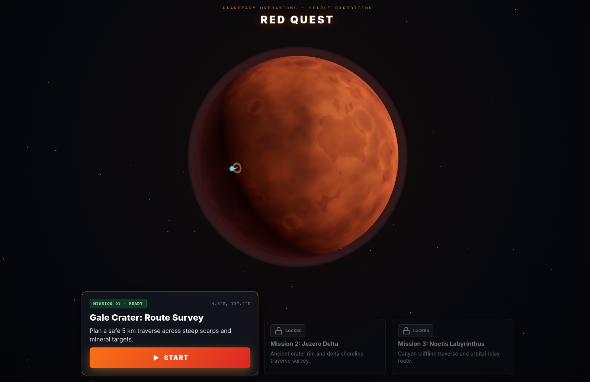

---

## Table of Contents

- [1. Abstract](#1-abstract)
- [2. Challenge Alignment](#2-challenge-alignment)
- [3. Key Features](#3-key-features)
- [4. Screenshot Walkthrough](#4-screenshot-walkthrough)
- [5. Scientific Data and Provenance](#5-scientific-data-and-provenance)
- [6. Methodology](#6-methodology)
  - [6.1 Study-Area Selection and Spatial Bounds](#61-study-area-selection-and-spatial-bounds)
  - [6.2 Data Preparation and Grid Normalization](#62-data-preparation-and-grid-normalization)
  - [6.3 Slope Gradient Calculation and Safety Tiers](#63-slope-gradient-calculation-and-safety-tiers)
  - [6.4 Solar Insolation and Cast Shadow Model](#64-solar-insolation-and-cast-shadow-model)
  - [6.5 Sky-View Factor Radiation Shielding Proxy](#65-sky-view-factor-radiation-shielding-proxy)
  - [6.6 Worker-Accelerated A* Traverse Generation](#66-worker-accelerated-a-traverse-generation)
  - [6.7 Deterministic Environmental Feature Placement](#67-deterministic-environmental-feature-placement)
  - [6.8 Empirical Evaluation and Scoring Bands](#68-empirical-evaluation-and-scoring-bands)
- [7. System Architecture](#7-system-architecture)
  - [7.1 High-Level Architecture](#71-high-level-architecture)
  - [7.2 Data Processing Pipeline](#72-data-processing-pipeline)
  - [7.3 Game State Lifecycle](#73-game-state-lifecycle)
  - [7.4 Multi-Layer Composite Render Stack](#74-multi-layer-composite-render-stack)
- [8. Quantitative Validation](#8-quantitative-validation)
- [9. Limitations and Operational Assumptions](#9-limitations-and-operational-assumptions)
- [10. Getting Started](#10-getting-started)
  - [10.1 System Requirements](#101-system-requirements)
  - [10.2 Installation and Local Development](#102-installation-and-local-development)
  - [10.3 Production Build and Preview](#103-production-build-and-preview)
  - [10.4 Repository Structure](#104-repository-structure)
  - [10.5 Offline Data Regeneration](#105-offline-data-regeneration)
- [11. Development Roadmap](#11-development-roadmap)
- [12. Team, Attribution, and License](#12-team-attribution-and-license)

---

## 1. Abstract

Mars datasets arrive from separate instruments, in different projections, and in formats that no field user can cross-read in real time. A traverse planner cannot readily overlay orbital slope hazards, spectral mineralogy and surface thermal brightness on the same terrain model, nor judge how those layers translate into driving cost before committing to a route.

Red Quest puts those layers on one 5 km × 5 km sector of Mount Sharp and turns them into a planning decision. The player inspects six analytical lenses, probes candidate corridors with a limited survey budget, locks in one of three computed traverses, then drives it in a third-person rover simulation scored against the DEM. The sector follows the ground covered by NASA's MSL Curiosity rover between Sol 3721 and Sol 4868, and the rover's actual path is withheld until the debrief, where it becomes the comparison baseline.

---

## 2. Challenge Alignment

Built for the NASA Space Apps Challenge category **Interplanetary Survival Guide: Martian Map**. Each criterion is mapped to the component that implements it.

| Challenge Criterion | Technical Implementation in Red Quest | Repository Component |
| :--- | :--- | :--- |
| **Multi-Source Data Integration** | Five data types fused in one scene: 1 m Gale DEM, HiRISE colour orthoimage, THEMIS Day IR, CRISM multispectral products, MSL localized traverse. | `public/data/`, `src/config.js`, `docs/DATA_SOURCES.md` |
| **Astronaut Safety & Hazard Detection** | Slope tiers (<15°, 15°–25°, >25°), sky-view factor radiation shielding, thermal and dust hazard detection, rockfall and radio occlusion zones. | `src/game/decisionLenses.js`, `src/game/surveyKit.js`, `src/game/terrainAnalysisWorker.js` |
| **Obstacle Avoidance & Pathfinding** | Asynchronous A* in a dedicated Web Worker, hard barrier at 25° slope, three candidate corridors with different cost weightings. | `src/routeWorker.js`, `src/game/levels/level01.json` |
| **Layered Multi-Spectral Visualization** | Six real-time lenses (Satellite, Terrain, Minerals, Heat, Sun & Power, Radiation Shelter) toggled non-destructively over true topography. | `src/game/decisionLenses.js`, `src/main.js` |
| **Scientific Waypoints & Resource Discovery** | 18 mission elements in four families (science, hazard, resource, mystery) placed on DEM and CRISM constraints, with the three science targets matched to Curiosity campaign sites. | `src/game/levels/level01_elements.json`, `src/game/missionElements.js` |
| **Rigorous Ground-Truth Debrief** | Pre-lock estimates scored against DEM-derived truth, plus an overlay of the real Curiosity traverse the player never saw. | `src/game/surveyLog.js`, `src/game/routeCalculator.js` |

---

## 3. Key Features

**Five-stage mission loop.** `BRIEFING` (dossier, coordinates, objectives) → `ANALYZE` (lens inspection, survey probes, route comparison) → `CHOOSE` (metric estimates, route lock-in) → `EXPLORE` (rover drive, telemetry, waypoints) → `DEBRIEF` (ground-truth scoring and traverse overlay).

**Six analytical decision lenses.**

- `Satellite` — HiRISE colour surface context at 2 m/pixel.
- `Terrain` — slope ramp (<15° green, 15°–25° yellow, >25° red) with 25 m elevation contours.
- `Minerals` — dual-channel CRISM index separating phyllosilicate clay from polyhydrated sulfate.
- `Heat` — THEMIS Day IR relative thermal brightness, distinguishing bedrock pavement from loose drift.
- `Sun & Power` — insolation and cast shadows at three solar presets: morning (22° elevation, 80° azimuth), noon (68°/350°), evening (18°/275°).
- `Radiation Shelter` — sky-view factor occlusion, with SVF < 0.85 marked as sheltered under the mission rule.

**Three candidate traverses**, presented blind as Route A, B and C.

| Route | Strategy | Distance | Cumulative ascent | Max slope | Easy / moderate slopes |
| :--- | :--- | :--- | :--- | :--- | :--- |
| **Route A** — Low-slope corridor | Safest | 3.322 km | 266.5 m | 18.4° | 99.3% / 0.7% |
| **Route B** — Direct traverse | Shortest | 2.971 km | 261.6 m | 23.8° | 91.5% / 8.5% |
| **Route C** — Mineral survey loop | Science | 4.103 km | 385.9 m | 24.8° | 82.0% / 18.0% |

All three climb 239 m net. All three distances, ascents and slope figures are `MEASURED` from the DEM along each corridor.

**Field Survey Kit.** Probes for slope, hazard, dust and element identification, with a budget of 8 corridor scans. Point reads, element identification and repeats stay free.

**Physical traverse simulation.** Terrain-normal alignment, wheel dust, slope-dependent battery drain, oxygen and radiation telemetry, waypoint surveying.

**Unconstrained Research mode.** Free layer toggles, arbitrary start and goal waypoints, manual A* recalculation, and coordinate inspection with full telemetry readout.

**Terrain-wide slope distribution.** 65.5% of the sector is below 15°, 19.7% sits between 15° and 25°, and 14.8% exceeds 25°.

---

## 4. Screenshot Walkthrough

Nine captures from the running build, in mission order.

### 01. Mission Briefing and Regional Dossier
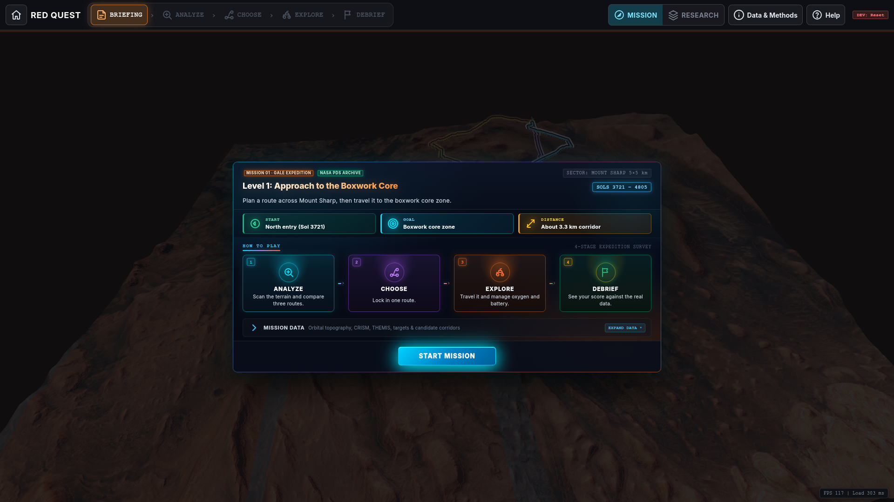
*Briefing screen with the Mount Sharp slope sector coordinates, the −3,857.5 m to −3,617.2 m traverse elevation band, primary science waypoints and the four-stage objective list.*

### 02. Multi-Route Traverse Analysis
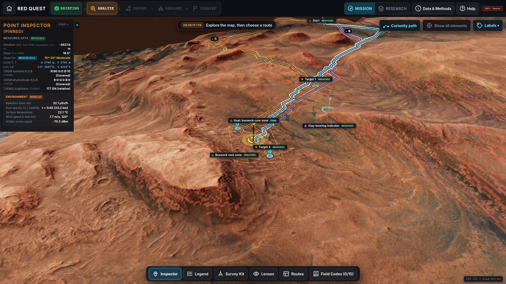
*ANALYZE stage: the 3D surface model with three computed corridors (Route A, Route B, Route C) and the blinded comparison table.*

### 03. CRISM Spectral Mineralogy Lens
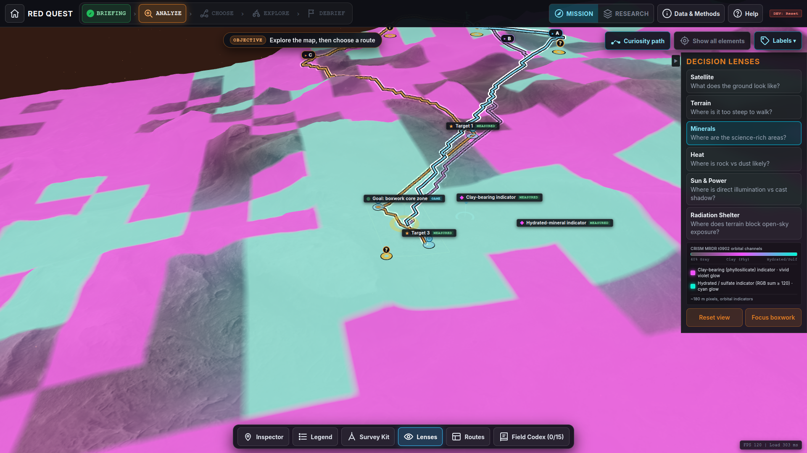
*Minerals lens rendering CRISM summary products: phyllosilicate clay in magenta, polyhydrated sulfate in cyan.*

### 04. THEMIS Thermal Brightness Lens
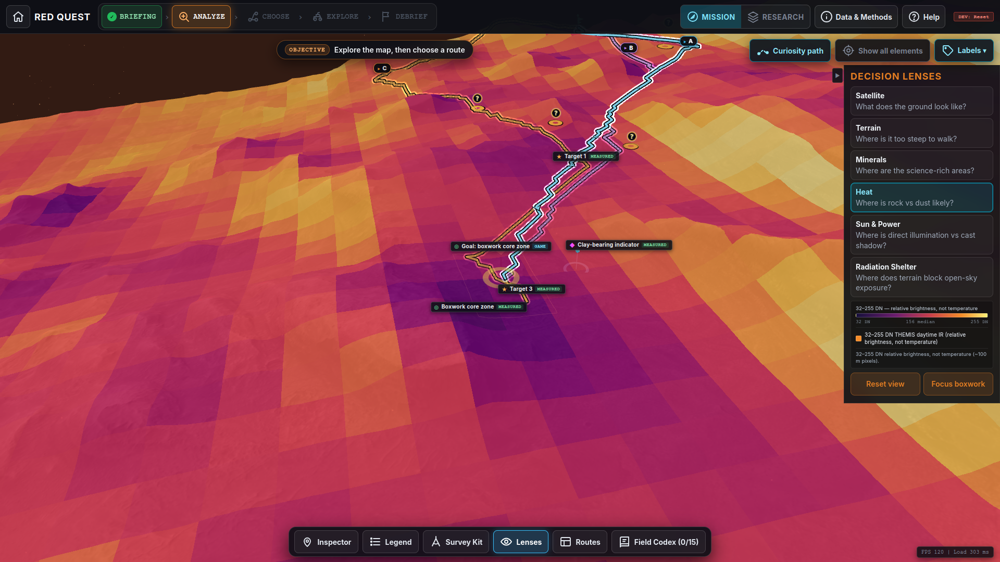
*Heat lens showing THEMIS Day IR relative brightness (32–255 DN) across the 5 km × 5 km sector.*

### 05. Field Survey Diagnostic Kit
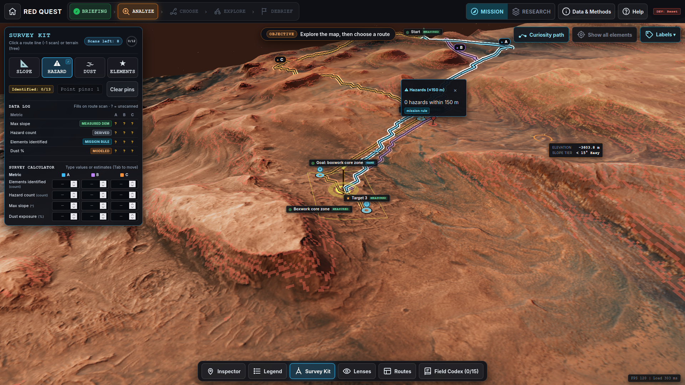
*Survey Kit with point probes and corridor scans across slope, hazard, dust and element categories, against the 8-scan budget.*

### 06. Corridor Selection and Route Certification
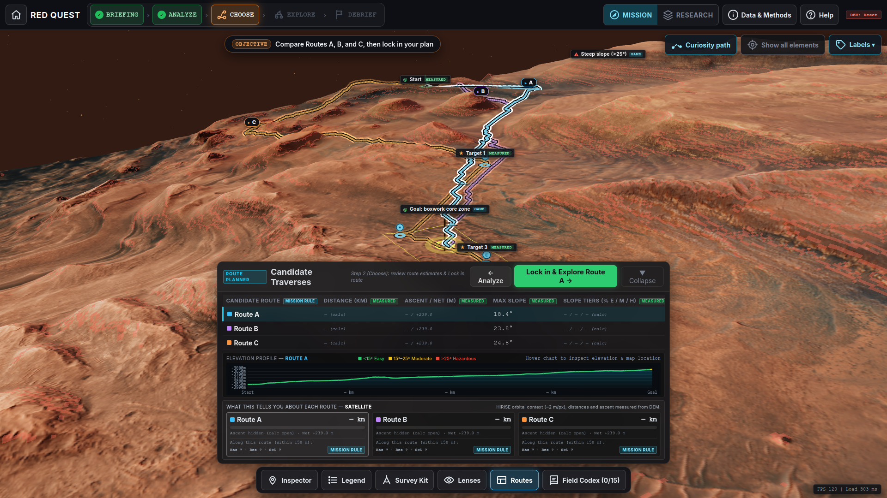
*CHOOSE stage comparing distance, cumulative ascent, maximum slope and identified targets before the route is locked.*

### 07. Surface Traversal and Systems HUD
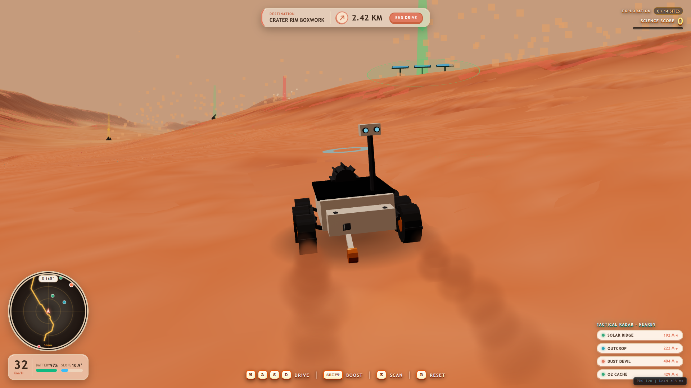
*EXPLORE stage: third-person rover driving with wheel dust, terrain alignment and live oxygen, battery and radiation telemetry.*

### 08. Mission Debrief and Ground-Truth Scoring
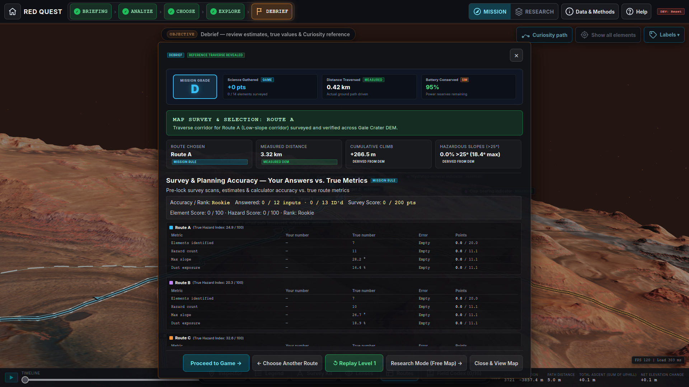
*DEBRIEF stage: scored estimates, survey accuracy, and the overlay against the genuine Curiosity traverse.*

### 09. Research GIS and Analysis Mode
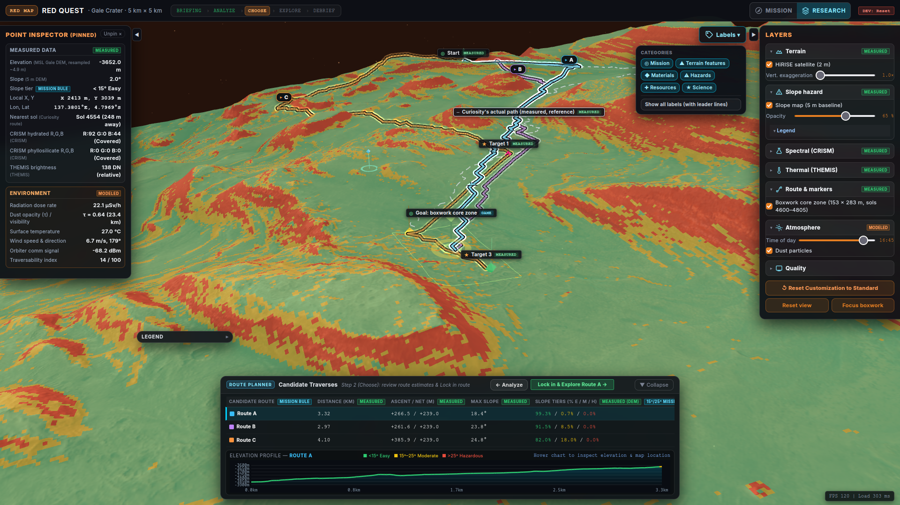
*RESEARCH mode: free layer toggles, pinned point inspection with measured coordinates and telemetry, full crater terrain analysis.*

---

## 5. Scientific Data and Provenance

Every value shown to the player carries one of four tags:

- `MEASURED` — read or geometrically derived from a NASA/PDS product.
- `DERIVED` — a deterministic algorithmic result computed from a measured raster. A subset of measured.
- `MODELED` — a physical simulation produced by a formula. Displayed in the interface as `SIM`.
- `MISSION RULE` — a game constraint chosen by us, not a NASA limit. Displayed in the interface as `game`.

### 5.1 Datasets in use

| Dataset | Product | Provider / archive | Native resolution | Extent |
| :--- | :--- | :--- | :--- | :--- |
| Gale crater elevation | `MSL_Gale_DEM_Mosaic_1m_v3.tif` | USGS Astrogeology Science Center | 1 m/px | 5 km × 5 km |
| Surface orthoimage | `MSL_Gale_HiRISE-LRGB_78quads_sharp_cog.tif` | NASA MRO HiRISE, University of Arizona | 0.25 m/px | 5 km × 5 km |
| Daytime thermal IR | `THEMIS_DayIR_ControlledMosaic_Aeolis_30S135E_100mpp.tif` | Mars Odyssey THEMIS, Arizona State University | 100 m/px | 5 km × 5 km |
| Spectral mineralogy | `t0902_mrrhyd_05s138_0327_4`, `t0902_mrrphy_05s138_0327_4` | NASA MRO CRISM, JHU Applied Physics Laboratory | ~181 m/px | 27 × 28 px crop |
| Rover traverse | `MSL-M-ROVER-6-RDR-PLACES-V1.0`, file `localized_interp.csv` | NASA PDS Geosciences | Sub-metre waypoints | Sols 3721–4868, 1,819 points |
| Radiation environment | `MSL-M-RAD-3-RDR-V1.0` | PDS Planetary Plasma Interactions | In-situ dosimetry | Regional baseline only |
| Atmospheric weather (REMS) | Not acquired | — | — | Not integrated at runtime |

### 5.2 Runtime assets and provenance

| Runtime asset | Derived from | Role | Provenance |
| :--- | :--- | :--- | :--- |
| `terrain_height.bin` | Gale DEM, cropped and resampled | 1025 × 1025 Float32 elevation grid, displaces the terrain mesh | `MEASURED` |
| `slope_5m.bin` | Gale DEM, 5 m baseline central difference | Slope field driving grade resistance, tier classification and survey scans | `DERIVED` |
| `slope_classified.png`, `slope_5m_classified.png` | Slope field plus tier thresholds | Traversability maps for the Terrain lens | `DERIVED` (thresholds `MISSION RULE`) |
| `terrain_texture.png` | HiRISE orthoimage, 8× downsample | 2500 × 2500 surface texture at 2 m/px | `MEASURED` |
| `themis_crop.png` | THEMIS Day IR mosaic | Heat lens, 50 × 50 px at 100 m/px, relative brightness only | `MEASURED` |
| `crism_hyd_crop.png`, `crism_phy_crop.png` | CRISM summary products | Minerals lens, two channels at ~181 m/px | `MEASURED` |
| `route.json` | MSL localized traverse, thinned to ~5 m spacing | Reference path, level start point, debrief overlay | `MEASURED` |
| Drive time, energy, dose, risk, dust, temperature, wind | Formulas in `docs/SIMULATED_DATA.md` | Route metrics and HUD telemetry | `MODELED` (`SIM`) |
| Slope tiers, scan budget, scoring thresholds, element placement rules | Game design | Constraints and scoring | `MISSION RULE` (`game`) |

### 5.3 Dataset citations

- **Gale DEM**: Fergason, R. L., et al. (2012), *Gale Crater elevation model derived from HiRISE and CTX stereo imagery*, USGS Astrogeology Science Center.
- **MRO HiRISE**: McEwen, A. S., et al. (2007), *Mars Reconnaissance Orbiter's High Resolution Imaging Science Experiment (HiRISE)*, J. Geophys. Res., 112, E05S02. [HiRISE Operations Center](https://hirise.lpl.arizona.edu/).
- **MRO CRISM**: Murchie, S., et al. (2007), *Compact Reconnaissance Imaging Spectrometer for Mars (CRISM) on Mars Reconnaissance Orbiter (MRO)*, J. Geophys. Res., 112, E05S03. Tile `frt0000t0902_07_mrdr`. Summary products defined by Viviano-Beck, C. E., et al. (2014), J. Geophys. Res. Planets, 119, 1403–1431.
- **Mars Odyssey THEMIS**: Christensen, P. R., et al. (2004), *The Thermal Emission Imaging System (THEMIS) for the Mars 2001 Odyssey Mission*, Space Sci. Rev., 110(1), 85–130. [THEMIS archive](https://themis.asu.edu/).
- **MSL traverse and RAD**: Hassler, D. M., et al. (2014), *Mars' Surface Radiation Environment Measured with the Mars Science Laboratory's Curiosity Rover*, Science, 343(6169), 1244797.

---

## 6. Methodology

### 6.1 Study-Area Selection and Spatial Bounds

The sector covers the ascent corridor of Curiosity on the northern flank of Aeolis Mons (Mount Sharp), where the clay-bearing unit transitions into the Gediz Vallis ridge and the polygonally fractured boxwork core.

- **Spatial extent**: 5,000 m × 5,000 m (25 km²), equirectangular on the Mars 2000 sphere (R = 3,396,190 m).
- **Projected bounds**: easting 8,140,750 m to 8,145,750 m, northing −287,375 m to −282,375 m.
- **Geographic bounds**: 137.3394° E to 137.4237° E, 4.7638° S to 4.8482° S. Center 4.8060° S, 137.3815° E.
- **Elevation range**: −4,131.74 m to −3,078.41 m, a total relief of 1,053.33 m.
- **Level 1 traverse**: start at X 3467.35 m, Y 4999.58 m, elevation −3857.48 m (Sol 3721), climbing to the boxwork core at X 2432.10 m, Y 2479.00 m, elevation −3617.23 m. The core zone spans Sols 4600–4805.

### 6.2 Data Preparation and Grid Normalization

1. The 1 m Gale DEM was cropped to the 5 km box, giving a 5,000 × 5,000 px raster.
2. It was resampled to a 1025 × 1025 regular grid, so the effective spacing is 4.8828125 m.
3. The grid is written as raw IEEE 754 Float32, little-endian, row-major with the north row first, into `terrain_height.bin` (4,202,500 bytes).
4. At runtime the buffer is read into a `Float32Array` and displaces the 1025 × 1025 plane geometry directly. There is no texture decode step and no quantisation error.

### 6.3 Slope Gradient Calculation and Safety Tiers

Slopes are computed offline with a central difference operator on the 5 m baseline:

```
dz_dx = (Z(x + 1, y) - Z(x - 1, y)) / (2 * grid_step)
dz_dy = (Z(x, y + 1) - Z(x, y - 1)) / (2 * grid_step)
slope_radians = atan(sqrt(dz_dx^2 + dz_dy^2))
slope_degrees = slope_radians * (180.0 / pi)
```

`grid_step = 4.8828125 m`. Results are capped at 60° and written to `slope_5m.bin`, the field the runtime actually reads. Tiers:

- **Easy (< 15.0°)** covers 65.5% of the sector. Nominal locomotion, low slip risk.
- **Moderate (15.0° to 25.0°)** covers 19.7%. Wheel slip and higher power draw, needs attention.
- **Hazardous (> 25.0°)** covers 14.8%. Rollover risk. Treated as impassable in routing.

These thresholds are a mission rule, not a NASA limit.

### 6.4 Solar Insolation and Cast Shadow Model

Shadows are computed in `terrainAnalysisWorker.js` for three solar presets:

1. **Morning**: 22.0° elevation, 80.0° azimuth.
2. **Noon**: 68.0° elevation, 350.0° azimuth.
3. **Evening**: 18.0° elevation, 275.0° azimuth.

Each cell first receives a direct incidence term from the surface normal. A second pass then marches outward along the sun azimuth across 17 radial offsets, up to roughly 1.2 km, and flags the origin cell as occluded wherever terrain rises above the ray height at that offset. Shadowed cells are written to an RGBA overlay texture for the Sun & Power lens.

### 6.5 Sky-View Factor Radiation Shielding Proxy

Galactic cosmic rays arrive nearly isotropically, so terrain relief is the only practical shield on the surface. Sky-view factor measures the fraction of the upper hemisphere still visible from a point. It is computed over 12 azimuths:

```
horizon(az)  = max over radii of atan((Z_target - Z_origin) / horizontal_distance)
SVF          = 1 - (1 / 12) * sum over azimuths of sin(horizon(az))
```

Rays extend across 12 radial offsets out to roughly 1.1 km. Open ground returns `SVF → 1.0`. Scarp bases and canyon walls fall below 0.85, which the mission rule designates a **Natural Radiation Shelter**.

### 6.6 Worker-Accelerated A* Traverse Generation

Pathfinding runs in a Web Worker so it never blocks the render loop. The graph is the DEM grid downsampled to 257 × 257 nodes, with 8-directional connectivity at the effective 4.88 m step. Base step cost is the 3D segment length `d`, which already includes the elevation change.

Three cost profiles produce the three candidates:

- **Route A, safest**: `d * (1 + (slope / 25) * 0.05)`. Slope barely registers, so the search minimises energy and vertical work.
- **Route B, shortest**: `d * (1 + (slope / 25) * 0.2) + ascent * 28`. A heavy penalty on climbing, which keeps the path direct without breaching the slope ceiling.
- **Route C, science**: `d * (1 + (slope / 25) * 0.2) * sciFactor`, where `sciFactor` falls from 1.0 to 0.35 as a node approaches a science marker or CRISM pixel.

Any node above 25° slope is skipped outright, so no candidate can cross a hazardous face. Route C is routed through the western CRISM phyllosilicate pixel center and the three science targets, giving it its extra length and ascent.

### 6.7 Deterministic Environmental Feature Placement

18 mission elements are placed by a seeded generator (`seed 20261111`) rather than hand-positioned, so placement is reproducible and constrained by the rasters:

- **Science (8)**: three fixed Curiosity campaign targets (boxwork campaign start, ridge top, Nevado Sajama drill site), plus a boxwork ridge network, layered outcrop, clay-rich patch, mineral vein and concretion field.
- **Hazard (4)**: soft sand pocket in a DEM hollow, rockfall zone on a strict >25° face, dust devil corridor on an open flat, radio shadow behind a ridge occluded from the modeled orbiter direction.
- **Resource (4)**: radiation shelter in a low-SVF pocket, oxygen cache on an accessible bench, solar ridge on a high-TPI crest, comm relay on an exposed clear-sky crest.
- **Mystery (2)**: an anomalous radar reflector and a possible iron meteorite, resolved only by survey.

Spacing rules require 150 m between elements and 100 m clearance from start and goal, with one documented exception where the boxwork core zone is too small to satisfy both.

### 6.8 Empirical Evaluation and Scoring Bands

The debrief compares the player's pre-lock estimates against values computed from the DEM along the chosen corridor.

- **Route planner** grades each estimate as **Sharp** within 10% error, **Close** within 25%, or **Off** beyond that. Unanswered fields score nothing.
- **Survey Log** awards full credit for an estimate within 10% of truth, then tapers linearly to zero at 50%.
- **Rank** follows total score: Mission Lead at 150 and above, Surveyor at 85, Rookie below.

Four survey rows are scored: maximum slope, hazard count, elements identified, and dust exposure.

---

## 7. System Architecture

A client-side application using ES modules, WebGL through Three.js, and Web Workers for the expensive terrain passes. No server component and no runtime database.

### 7.1 High-Level Architecture

```mermaid
flowchart TD
    subgraph NASA_PDS["NASA Planetary Data Archives"]
        DEM[USGS Gale DEM 1 m]
        HIRISE[HiRISE Color Orthomosaic 0.25 m]
        THEMIS[THEMIS Day IR 100 m]
        CRISM[CRISM MRDR Tile t0902]
        TRAV[MSL Localized Traverse]
        RAD[MSL RAD Dosimetry]
    end

    subgraph OFFLINE_PIPELINE["Offline Python & Node Preprocessing"]
        PREP[scripts/generate_level01.mjs<br/>scripts/check_route_elev.py]
        NORM[Grid Resampling, Cropping & Normalization]
        EVAL[DEM Ground-Truth Validation]
    end

    subgraph STATIC_ASSETS["Browser Public Assets: public/data/"]
        ELEV_BIN[terrain_height.bin]
        SLOPE_BIN[slope_5m.bin]
        HI_PNG[terrain_texture.png]
        THEMIS_PNG[themis_crop.png]
        CRISM_PNG[crism_hyd / crism_phy]
        ROUTE_JSON[route.json]
    end

    subgraph BROWSER_ENGINE["Red Quest Client Engine"]
        THREE_APP[Three.js WebGL Renderer]
        SHADERS[Lens Shader Materials]
        FSM[State Machine: src/game/gameState.js]
        WORKER[A* Worker: src/routeWorker.js]
        TERRAIN[Terrain Worker: terrainAnalysisWorker.js]
        PHYSICS[Rover Kinematics & HUD]
        UI[HUD, Lenses, Survey Kit & Debrief]
    end

    NASA_PDS --> OFFLINE_PIPELINE
    OFFLINE_PIPELINE --> STATIC_ASSETS
    STATIC_ASSETS --> BROWSER_ENGINE
```

### 7.2 Data Processing Pipeline

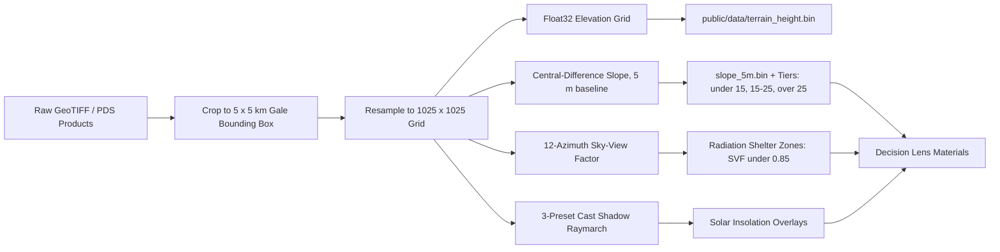

### 7.3 Game State Lifecycle


### 7.4 Multi-Layer Composite Render Stack

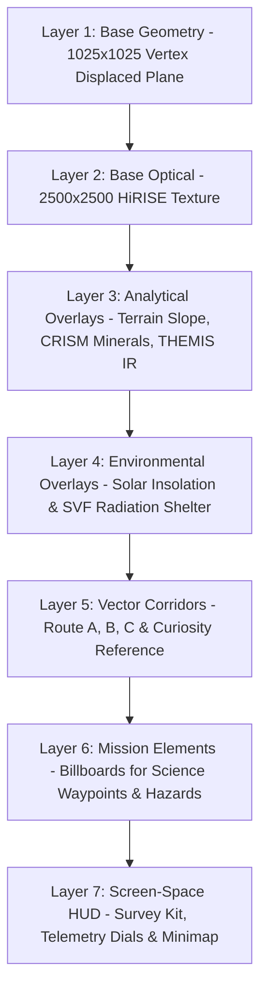

---

## 8. Quantitative Validation

`scripts/check_route_elev.py` tests the derived heightmap against the one independent measurement available: the 1,819 localised positions of the rover itself. Every point is bilinearly interpolated from `terrain_height.bin` and compared with the position's own reported elevation.

```
Total Traverse Waypoints Evaluated: 1,819 points
Traverse Distance Covered:           7,191.2 meters (3D)
Cumulative Ascent:                   465.1 meters
Net Elevation Gained:                286.8 meters
Elevation Range Along Traverse:      -3,857.6 m to -3,570.7 m

Evaluation Metrics (Traverse vs. Heightmap):
- Mean Absolute Error (MAE):         0.197 meters
- Median Absolute Error:             0.129 meters
- Root Mean Square Error (RMSE):     0.296 meters
- Maximum Absolute Error:            1.802 meters
- 95th Percentile Error:             0.647 meters
```

**Interpretation.** 95% of the 1,819 measured rover positions agree with the derived heightmap to within 65 cm vertically. The MAE is 20 cm. Errors approaching the 1.80 m maximum occur at scarp crests, where a 4.88 m horizontal grid necessarily averages across sub-metre relief.

---

## 9. Limitations and Operational Assumptions

1. **CRISM spatial footprint.** The multispectral products are ~181 m per pixel, so a native tile is only 27 × 28 px across this sector. The Minerals lens shows regionally dominant mineralogy, not a sampled mineral. Route C's `sciFactor` attraction is therefore a coarse regional gradient.
2. **THEMIS thermal digital numbers.** The Heat lens shows relative brightness (32–255 DN), not calibrated surface temperature in kelvin. A co-registration variance of 150–275 m against the HiRISE baseline is possible.
3. **Modeled environment.** The runtime uses a fixed 20 µSv/h background dose rate modulated by elevation and exposure, and dust and weather follow static rules. Hassler et al. (2014) reported roughly 0.64 mSv/day dose equivalent at the surface, which is the literature anchor, not a runtime input.
4. **Safety tiers versus physical limits.** The <15° / 15°–25° / >25° tiers are operational constraints for EVA walking and rover chassis protection. A slope above 25° is not physically unclimbable.
5. **Curiosity chronology.** Sol numbers, campaign names and drill site labels come from published JPL mission status logs and the MSL Analyst's Notebook.
6. **Route metrics are corridor properties.** Distance, ascent and slope statistics describe the corridor the planner draws, not the executed drive. Drive time, energy, dose and risk are `SIM` estimates from `docs/SIMULATED_DATA.md`.

---

## 10. Getting Started

### 10.1 System Requirements

- A browser with WebGL 2.0 support: Chrome 110+, Firefox 115+, Safari 16+, Edge 110+.
- Node.js 18 or newer with `npm`.
- GPU hardware acceleration enabled.

### 10.2 Installation and Local Development

```bash
git clone https://github.com/Erebo/red-quest.git
cd red-quest
npm install
npm run dev
```

Open `http://localhost:5173/`, or whichever port Vite reports.

### 10.3 Production Build and Preview

```bash
# Bundle to dist/
npm run build

# Preview the production build on port 4173
npm run preview
```

### 10.4 Repository Structure

```
red-quest/
├── docs/
│   ├── DATA_SOURCES.md          # Raw and processed dataset inventory
│   ├── SIMULATED_DATA.md        # Formulas for drive time, energy, dose, risk
│   ├── AREA_CANDIDATES.md       # Sector selection matrix
│   ├── SUBMISSION_AI_AND_REFERENCES.md
│   ├── screenshots/             # Walkthrough captures, 1920x1080
│   └── *.mp3                    # Rover audio cues
├── data/
│   ├── raw/                     # Original PDS products, read-only
│   └── processed/               # Cropped and resampled intermediates
├── public/
│   └── data/                    # Web-ready assets the browser reads
│       ├── manifest.json        # Bounds, projection, asset index
│       ├── terrain_height.bin   # 1025x1025 Float32 elevation grid
│       ├── slope_5m.bin         # 1025x1025 Float32 slope field
│       ├── terrain_texture.png  # 2500x2500 HiRISE colour texture
│       ├── themis_crop.png      # 50x50 THEMIS brightness
│       ├── crism_hyd_crop.png   # 27x28 hydrated minerals
│       ├── crism_phy_crop.png   # 27x28 phyllosilicates
│       └── route.json           # 1,819-point Curiosity traverse
├── scripts/
│   ├── check_route_elev.py      # DEM versus traverse elevation validator
│   ├── generate_level01.mjs     # Level corridor and cost-surface generator
│   └── take_screenshots.mjs     # Playwright capture suite
├── src/
│   ├── main.js                  # Bootstrap, render loop, UI orchestration
│   ├── config.js                # Scoring config, sliders, planner bands
│   ├── style.css                # Interface styling
│   ├── routeWorker.js           # A* pathfinding worker (257x257 graph)
│   ├── game/
│   │   ├── gameState.js         # Five-state machine
│   │   ├── decisionLenses.js    # Lens definitions and materials
│   │   ├── terrainAnalysisWorker.js  # Slope, shadow and SVF passes
│   │   ├── surveyKit.js         # Point and corridor probes
│   │   ├── surveyLog.js         # Pre-lock ledger and accuracy scoring
│   │   ├── routeCalculator.js   # Planner estimates and Sharp/Close/Off bands
│   │   ├── missionElements.js   # Element billboards and interaction
│   │   ├── dustZones.js         # Dust zone membership tests
│   │   ├── mapLabels.js         # Map label layout and fading
│   │   ├── levelController.js   # Level load and lifecycle
│   │   ├── tutorialSteps.js     # Guided tutorial steps
│   │   ├── rover/               # Driving physics, audio, HUD, ribbon trail
│   │   └── levels/              # level01.json and element definitions
│   └── ui/                      # Mission select globe, intro, tutorial
├── index.html
├── package.json
└── vite.config.js
```

### 10.5 Offline Data Regeneration

The browser only reads pre-processed assets from `public/data/`. To re-derive them:

```bash
# Validate traverse elevations against the heightmap
python scripts/check_route_elev.py

# Recompute the level and its candidate routes
node scripts/generate_level01.mjs
```

Full regeneration from the archives needs the original USGS 1 m GeoTIFF and the PDS products listed in `docs/DATA_SOURCES.md`.

> `generate_level01.mjs` rewrites `src/game/levels/level01.json` in place and restores default provenance tags and route names. Review the diff before committing.

---

## 11. Development Roadmap

- [ ] **Multi-sector expansion**: add the Jezero delta (Perseverance traverse) and Mawrth Vallis clay formations.
- [ ] **Live weather integration**: ingest REMS daily pressure, air temperature and opacity instead of static rules.
- [ ] **Dune migration hazard**: particle simulation of saltating ripples driven by prevailing local winds.
- [ ] **Panel dust accumulation**: model photovoltaic efficiency decay and cleaning events over long surface stays.
- [ ] **WebXR support**: stereoscopic headset mode for cockpit-style traverse rehearsal.

---

## 12. Team, Attribution, and License

### Development Team — Astro Dots
- **Mahadi Rahman Jihad** — *Team Lead and System Designer*
- **Tahseen Alam Taseen** — *Visual and Media Lead*
- **Tartib Kaiser Munna** — *Application Developer*
- **Tasfia Mozumder Aupy** — *Research and Documentation Lead*

### Engineering and Tooling Note
This application was engineered using **Vite**, **Three.js**, and modern web standards, developed with agentic IDE assistance for rapid prototyping and scientific dataset integration.

### Institutional Acknowledgments
We express our gratitude to the planetary scientists, mission engineers, and archive managers whose dedication makes exploration data accessible to the global public:
- **NASA** (National Aeronautics and Space Administration)
- **USGS Astrogeology Science Center**
- **NASA Planetary Data System (PDS) Geosciences Node**
- **University of Arizona HiRISE Operations Center**
- **Johns Hopkins University Applied Physics Laboratory (CRISM Team)**
- **Arizona State University Mars Space Flight Facility (THEMIS Team)**
- **NASA Jet Propulsion Laboratory / Mars Science Laboratory Curiosity Team**

### License
This project is licensed under the **MIT License**. See the [LICENSE](LICENSE) file for complete details.
