<!--
  Proposed replacement for README.md.

  This file is not wired into the app. It is a corrected, shortened draft.
  Every number here was re-derived from public/data/, src/game/levels/level01.json,
  and a fresh run of scripts/check_route_elev.py on 2026-11-13.

  Items still requiring your input are marked PLACEHOLDER.
-->

# Red Quest

**Read the land. Survive the red.**

A browser-based Mars traverse planner: orbital terrain, mineral and thermal data fused into six analytical lenses over a real 5 km × 5 km sector of Gale Crater, with an A* route planner, a drivable rover, and a scored debrief against Curiosity's actual traverse.

[](LICENSE)
[](https://threejs.org/)
[](https://vitejs.dev/)
[](https://www.spaceappschallenge.org/2026/challenges/interplanetary-survival-guide-martian-map/?tab=details)

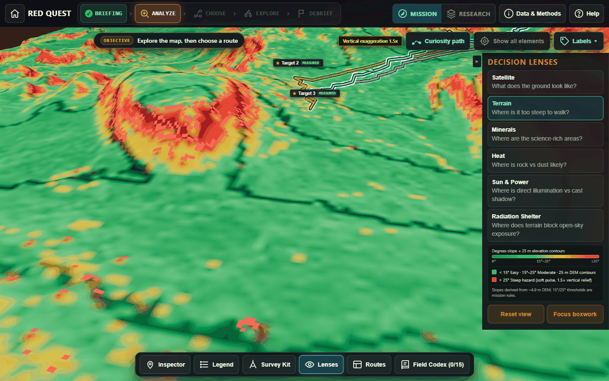

**Live demo:** `PLACEHOLDER_URL` · **Demo video:** `PLACEHOLDER_URL` · **Built for:** [Interplanetary Survival Guide: Martian Map](https://www.spaceappschallenge.org/2026/challenges/interplanetary-survival-guide-martian-map/?tab=details), NASA Space Apps Challenge 2026

---

## The 60-second judge path

1. **Open the demo** — the intro globe leads to Mission Select → *Gale Crater*.
2. **ANALYZE** — cycle all six lenses over the same 3D terrain, then spend part of the 8-scan survey budget on the corridors.
3. **CHOOSE** — compare the three candidate routes and lock one in.
4. **EXPLORE** — drive the terrain with `WASD` / arrows, `Shift` to boost, `E` to survey, `R` to reset.
5. **DEBRIEF** — your pre-lock estimates are revealed against the computed truth and against Curiosity's real path.

No install required. Desktop browser with WebGL 2.0.

---

## What it does

- **Six decision lenses, one terrain.** Satellite (HiRISE), Terrain (slope + 25 m contours), Minerals (CRISM browse indices), Heat (THEMIS daytime IR), Sun & Power (ray-cast shadows at three sun positions), Radiation Shelter (sky-view factor). Every layer is a non-destructive overlay on the same 1,025 × 1,025 elevation mesh.
- **Plan under uncertainty.** Three candidate corridors are precomputed by an A* planner that also runs live in a Web Worker; before locking in, the player sees only blinded labels and must buy diagnostics with a limited scan budget.
- **Get graded on reality.** The debrief reveals true DEM metrics, the composite hazard index, and Curiosity's traverse for the same sols. Estimation accuracy drives the score, not just distance driven.

---

## Challenge fit

- **Map** — a navigable 3D slice of Mars built from measured elevation rather than a stylized backdrop; every layer is co-registered to the same 5 km grid.
- **Survival** — slope hazards, radiation shelter, solar exposure and drive time are decisions the player must make before committing, not decoration.
- **Interplanetary** — the pipeline is region-agnostic: change the config bounding box and a different PDS-covered sector becomes playable.

---

## Data

All browser assets are pre-processed into `public/data/`. Raw archives are **not** committed (see [Reproducibility](#reproducibility)).

| Layer | Product | Provider / archive | Native resolution | Used in the app | Scale of evidence |
| :--- | :--- | :--- | :--- | :--- | :--- |
| Elevation | `MSL_Gale_DEM_Mosaic_1m_v3.tif` | USGS Astrogeology / PDS Geosciences | 1 m/px GeoTIFF | 1,025 × 1,025 Float32 grid at **4.883 m/px**; slope field | 1,050,625 cells |
| Optical | `MSL_Gale_HiRISE-LRGB_78quads_sharp_cog.tif` | MRO HiRISE / Univ. of Arizona / PDS | 0.25 m/px COG | 2,500 × 2,500 PNG at **2 m/px** | 6.25 M px |
| Thermal | `THEMIS_DayIR_ControlledMosaic_Aeolis_30S135E_100mpp.tif` | Mars Odyssey THEMIS / ASU / PDS | 100 m/px | 50 × 50 px crop, 32–255 DN relative brightness | **2,500 cells** |
| Minerals | `T0902_MRRHYD_05S138_0327_4`, `T0902_MRRPHY_05S138_0327_4` (`MRO-M-CRISM-5-RDR-MULTISPECTRAL-V1.0`) | MRO CRISM / JHU APL / PDS | 181.26 m/px | 27 × 28 px browse-product crops | **756 cells** |
| Traverse | `localized_interp` (MSL localized poses) | NASA JPL / MSL / PDS | pose solutions | 1,819 thinned points from 10,581 in-crop poses, Sols 3721–4868 | 323 distinct sols |
| Radiation baseline | `MSL-M-RAD-3-RDR-V1.0` | MSL RAD / SwRI / PDS | in situ | **Reference only** — a 20 µSv/h constant, not a derived product | — |
| Atmosphere | REMS | MSL / CAB / PDS | in situ | Not integrated | — |

**Study area:** 5,000 m × 5,000 m centred at **4.8060° S, 137.3815° E**, elevation **−4,131.74 m to −3,078.41 m** (1,053.33 m relief), projected easting 8,140,750–8,145,750 m / northing −287,375 to −282,375 m.

**Citation.** McEwen et al. (2007), *JGR* 112, E05S02 (HiRISE); Murchie et al. (2007), *JGR* 112, E05S03 (CRISM); Christensen et al. (2004), *Space Sci. Rev.* 110, 85–130 (THEMIS); Viviano-Beck et al. (2014), *JGR* 119 (CRISM spectral parameters, the basis of the HYD/PHY browse products); Hassler et al. (2014), *Science* 343, 1244797 (RAD surface dosimetry). Full product IDs, byte sizes and processing notes are in [`docs/DATA_SOURCES.md`](docs/DATA_SOURCES.md).

---

## Provenance: what is measured, what is modeled

Player-facing values are tagged with one of four labels.

| Tag | Meaning | Examples |
| :--- | :--- | :--- |
| **MEASURED** | Read directly from a PDS product, or sampled from one and expressed in the app's frame | Elevation, local x/y, lon/lat, route polyline, HiRISE colour, THEMIS DN, CRISM browse channels |
| **DERIVED** | Deterministic geometry computed from measured rasters | Slope angle, slope tier, 25 m contour bands, sky-view factor, cast shadows, cumulative ascent, route distance |
| **MODELED** | A formula, not an instrument reading (`SIM`) | Dose rate, dust opacity, surface temperature, wind, orbiter link budget, drive time, energy, risk score |
| **MISSION RULE** | A gameplay threshold or objective (`game`) | < 15° / 15–25° / > 25° tiers, SVF < 0.85 shelter, scan budget, scoring bands |

`DERIVED` is a sub-case of measured data; `MODELED` is what the AGENTS.md rule calls `SIM`. Formulas for every MODELED value are in [`docs/SIMULATED_DATA.md`](docs/SIMULATED_DATA.md).

---

## How it works

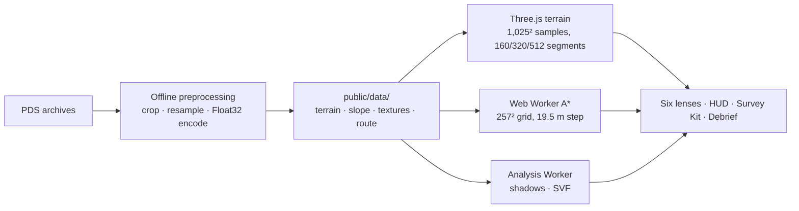

**Terrain.** The 1 m DEM is cropped, bilinearly resampled to 1,025 × 1,025 samples (4.883 m spacing) and shipped as raw little-endian Float32 (`terrain_height.bin`, 4.2 MB) — no 16-bit encoding step. The mesh is displaced at 160, 320 or 512 segments depending on quality.

**Slope.** The 1 m DEM is Gaussian-smoothed (σ ≈ 2.5 px), then central differences are taken over a 5 m baseline and capped at 60° (`slope_5m.bin`). Tiers classify that measured field using gameplay thresholds.

**Shadows and shelter.** Three sun presets — morning 22°/80°, noon 68°/350°, evening 18°/275° — drive an incidence hillshade plus a cast-shadow pass that walks a fixed radius ladder along the sun azimuth out to ~1.2 km. Shelter uses sky-view factor over 12 azimuths, `SVF = 1 − mean(sin(horizon))`, with `SVF < 0.85` marked as a mission-rule shelter.

**Routing.** A* runs in a Web Worker over a 257 × 257 subsample of the slope field (19.53 m step, 8-connected, binary-heap frontier, 3D step cost). Slopes above 25° are impassable. Four strategies exist — safest, shortest, energy (ascent-penalised) and science (attracted to CRISM and target cells) — and Level 1 presents the first, second and fourth as Routes A, B and C.

**Scoring.** The debrief scores 12 estimate slots: four metrics (element count, hazard count, max slope, dust exposure) across three routes. Accuracy is full credit at ≤ 10 % error, zero at ≥ 50 %, linear between. Ranks: Mission Lead ≥ 150, Surveyor ≥ 85, Rookie below.

---

## Accuracy and honesty

**Co-registration check.** `scripts/check_route_elev.py` compares all 1,819 shipped traverse points against the resampled DEM:

| Metric | Value |
| :--- | :--- |
| Mean absolute error | **0.197 m** |
| Median absolute error | 0.129 m |
| RMSE | 0.296 m |
| 95th percentile | **0.647 m** |
| Maximum absolute error | 1.802 m |

The traverse product ships its own DEM pixel coordinates, and both rasters are tied to HiRISE stereo topography, so this checks our crop-and-resample chain against the localization DEM — it is **not** a test of rover localization accuracy. The largest residuals cluster around the boxwork core (worst point: 1.80 m on a 10.7° slope), where 4.883 m/px averaging smooths sub-pixel relief; the median slope of the 20 worst points is 12.6°, so this is resolution, not cliff-edge geometry.

**Independent numbers.** Route lengths, ascent and slope distributions in `level01.json` are recomputed from the shipped slope and elevation grids by `scripts/generate_level01.mjs`, so they can be re-derived rather than trusted:

| Route | 3D length | Ascent | Net elevation | Max slope | Easy / Moderate / Hazardous | Science targets ≤ 100 m |
| :--- | ---: | ---: | ---: | ---: | :--- | :--- |
| A — low-slope corridor | 3.322 km | +266.5 m | +239 m | 18.4° | 99.3 % / 0.7 % / 0 % | 2 / 3 |
| B — direct traverse | 2.971 km | +261.6 m | +239 m | 23.8° | 91.5 % / 8.5 % / 0 % | 2 / 3 |
| C — mineral survey loop | 4.103 km | +385.9 m | +239 m | 24.8° | 82.0 % / 18.0 % / 0 % | 3 / 3 |
| Curiosity reference | 7.191 km | +465.1 m | +286.8 m | 28.6° | — | — |

Route C is the only corridor that comes within 100 m of all three drill/campaign targets; A and B both miss the Nevado Sajama drill site by ~102 m.

---

## Limitations

1. **Two of the six lenses are regional context, not reconnaissance.** THEMIS is 100 m/px (2,500 cells over the whole sector) and CRISM is 181.26 m/px (756 cells). Mineral colours are browse-product indices; the PDS label explicitly says spectral fitting is required for positive identification.
2. **Slope tiers are gameplay rules.** The < 15° / 15–25° / > 25° thresholds are challenge design for rover navigation, not NASA vehicle limits.
3. **The planner is coarser than the terrain.** Routing subsamples to 19.53 m cells, so fine-scale obstacles inside a cell are invisible to A*.
4. **Radiation, weather and mobility are formulas.** Dose rate, dust opacity, temperature, wind, link budget, drive time and risk score are deterministic `MODELED` values built from a literature baseline; no in-app instrument reading feeds them. REMS is not integrated.
5. **Science target sol labels** are compiled from public Curiosity campaign reporting and matched to the nearest shipped waypoint; sol-exact cross-checking against mission records is ongoing, and marker positions are rounded to that waypoint.
6. **Raw rasters are not in the repository.** The 1 m DEM and HiRISE mosaics exceed GitHub limits; only derived web assets are committed.

---

## Screenshots

<details>
<summary>Full walkthrough (10 screens)</summary>

| | |
| :--- | :--- |
| **Briefing** — study area, elevation range, objectives<br/>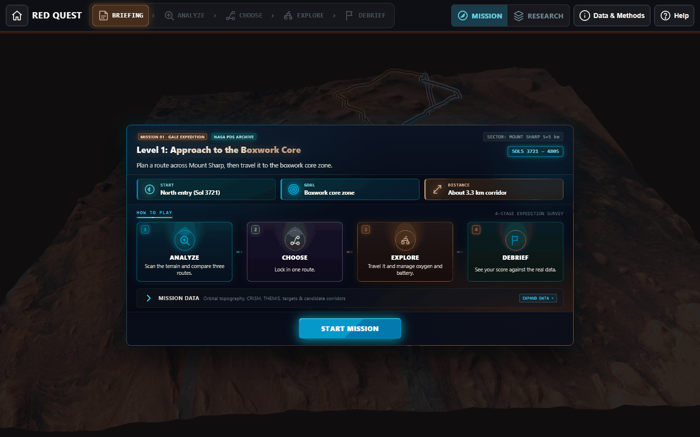 | **Route analysis** — three blinded corridors<br/>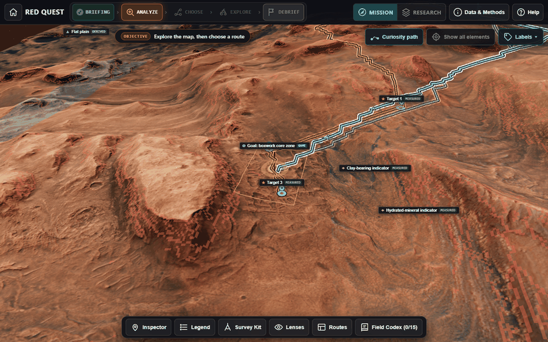 |
| **Terrain lens** — slope tiers and 25 m contours<br/> | **Minerals lens** — CRISM HYD/PHY browse indices<br/>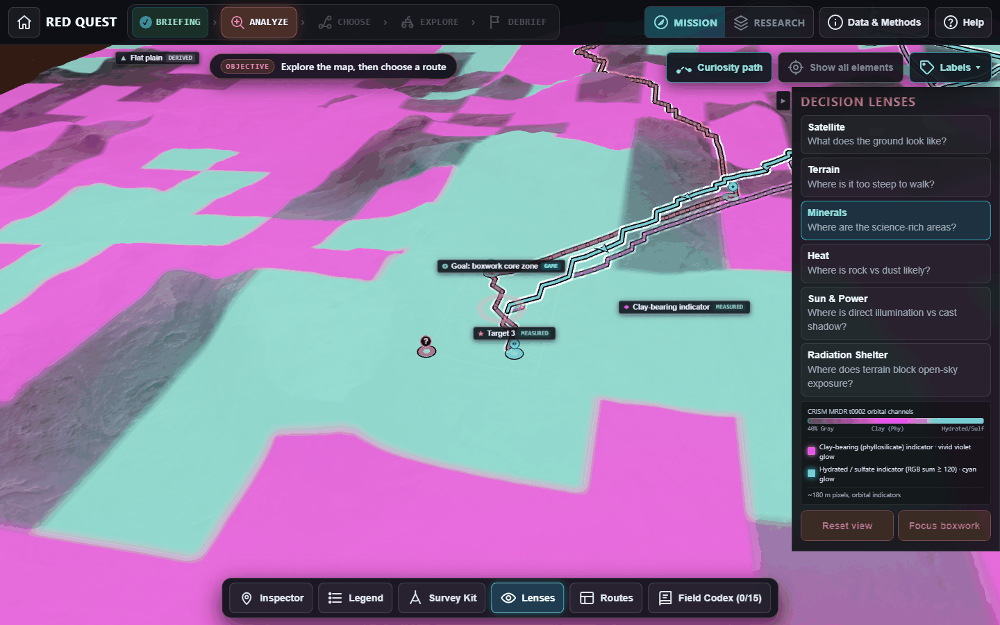 |
| **Heat lens** — THEMIS daytime brightness<br/>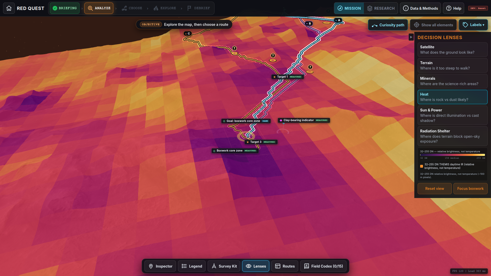 | **Sun & Power** — cast shadows at three sun positions<br/>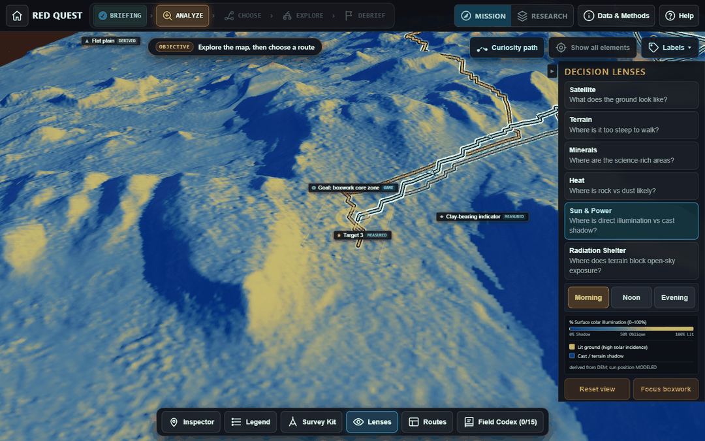 |
| **Survey Kit** — probe, scan, log, 8-scan budget<br/>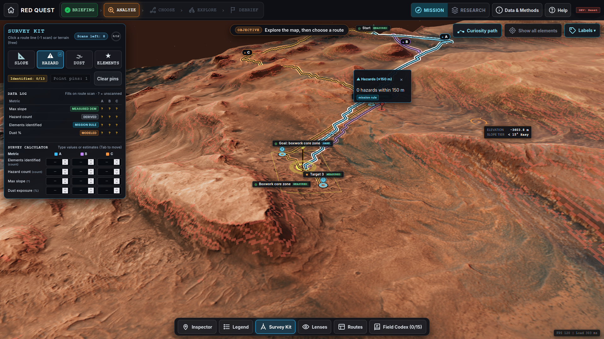 | **Lock-in** — route certification<br/>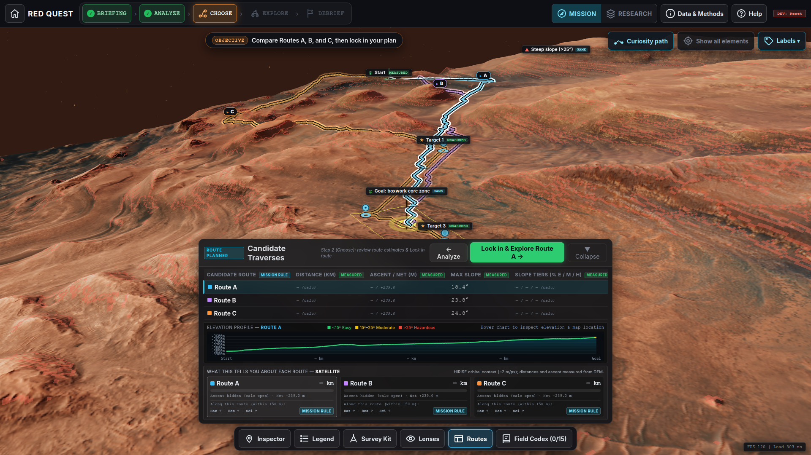 |
| **Explore** — 3D rover drive with live telemetry<br/>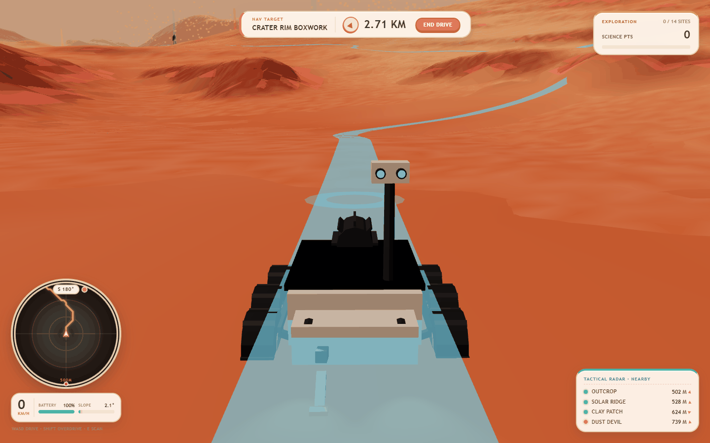 | **Debrief** — estimates vs truth, Curiosity overlay<br/>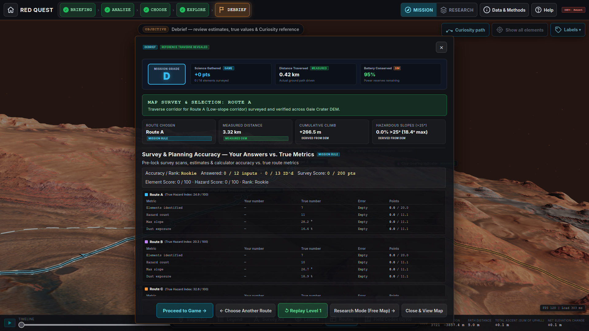 |

</details>

---

## Run locally

Requires Node.js 18+ and a WebGL 2.0 browser.

```bash
git clone https://github.com/Erebo/red-quest.git
cd red-quest
npm install
npm run dev        # http://localhost:5173
```

```bash
npm run build      # static bundle in dist/
npm run preview    # serve the build on :4173
```

### Reproducibility

The shipped `public/data/` assets can be validated and the level regenerated without any raw archives:

```bash
python scripts/check_route_elev.py    # DEM co-registration check (needs numpy)
node scripts/generate_level01.mjs     # recompute routes + metrics from shipped grids
```

> **Note:** `generate_level01.mjs` rewrites `src/game/levels/level01.json` and restores the generator's default route names and `SIM` tags. Geometry and metrics are unchanged, but any curated route copy should be re-applied afterwards. The committed file matches this script's output apart from those labels.

Full regeneration from archive sources additionally needs these files, which are intentionally gitignored:

| File | Size | Source |
| :--- | ---: | :--- |
| `MSL_Gale_DEM_Mosaic_1m_v3.tif` | 3.60 GB | USGS Astrogeology / PDS Geosciences |
| `MSL_Gale_HiRISE-LRGB_78quads_sharp_cog.tif` | 982.88 MB | HiRISE / PDS |
| `THEMIS_DayIR_ControlledMosaic_Aeolis_30S135E_100mpp.tif` | 452.51 MB | THEMIS / ASU / PDS |
| `t0902_mrrhyd_*.png`, `t0902_mrrphy_*.png` + labels | 5.55 MB | CRISM / PDS |
| `localized_interp.csv` + label | 11.21 MB | MSL / PDS |

---

## Repository layout

```
red-quest/
├── public/data/          # shipped web assets: terrain, slope, textures, route, manifest
├── data/raw/             # small PDS products (CRISM browse, RAD RDR, localized CSV)
├── data/processed/       # crops and web-ready intermediates (large TIFs gitignored)
├── scripts/
│   ├── check_route_elev.py    # DEM co-registration check
│   ├── generate_level01.mjs   # A* rerun + level01.json generation
│   └── take_screenshots.mjs   # Playwright capture
├── src/
│   ├── main.js                # bootstrap, render loop, lens and UI orchestration
│   ├── routeWorker.js         # A* pathfinding worker (257² grid, 4 strategies)
│   ├── game/
│   │   ├── terrainAnalysisWorker.js  # shadows + sky-view factor
│   │   ├── decisionLenses.js         # lens shaders, palettes, contour bands
│   │   ├── surveyKit.js              # probes, scans, 8-scan budget
│   │   ├── surveyLog.js              # estimates, hazard index, scoring
│   │   ├── missionElements.js        # 18 elements, 4 families
│   │   ├── levels/                   # level definition + deterministic placement rules
│   │   └── rover/                    # kinematics, dust, HUD, ribbon
│   └── ui/                    # intro, mission select, tutorial
└── docs/                      # data sources, simulated formulas, screenshots
```

---

## Roadmap

- [ ] Expand to Jezero Crater (Perseverance traverse) and Mawrth Vallis.
- [ ] Ingest REMS pressure, temperature and opacity instead of modeled weather.
- [ ] Add CRISM spectral fitting so minerals are identified, not indicated.
- [ ] Model photovoltaic dust accumulation and cleaning events.
- [ ] WebXR support for head-mounted traverse rehearsal.

---

## Team — Astro Dots

- **Mahadi Rahman Jihad** — Team lead, system design
- **Tahseen Alam Taseen** — Visual and media lead
- **Tartib Kaiser Munna** — Application developer
- **Tasfia Mozumder Aupy** — Research and documentation lead

Built with Vite and Three.js, with agentic IDE assistance for prototyping and dataset integration. Data courtesy of NASA, USGS Astrogeology, the PDS Geosciences Node, the HiRISE Operations Center, the CRISM team at JHU APL, the THEMIS team at ASU, and the MSL Curiosity team at JPL.

**License:** MIT — see [LICENSE](LICENSE).
